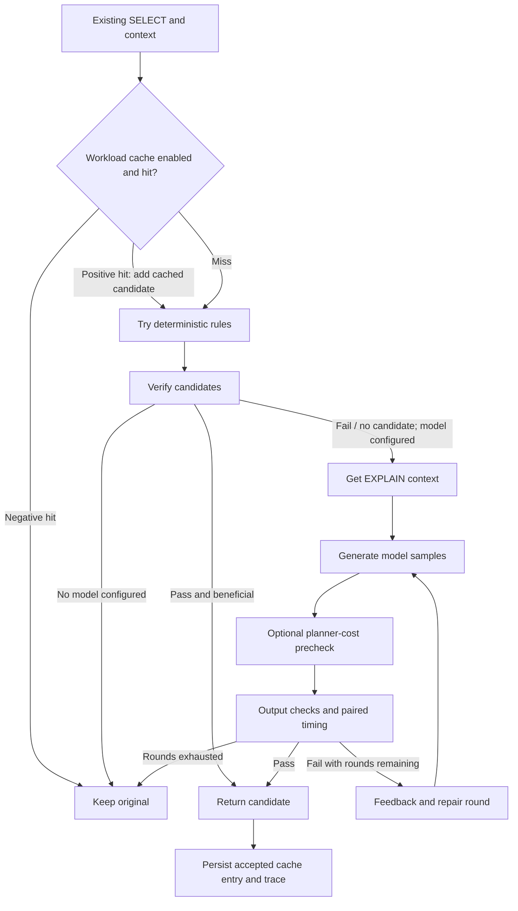
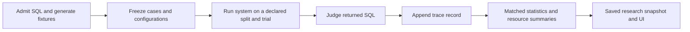
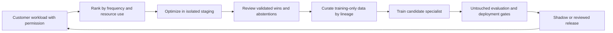

# Database Surgeon: the end-to-end study guide

Read this as a technical handbook and presentation preparation, not as a claim
that the project is already the best SQL optimizer. It explains the problem,
implementation, evidence, business hypothesis and remaining work together.

**Evidence date:** the UTC capture in [STUDY_EVIDENCE.json](STUDY_EVIDENCE.json).
That file pins inspected source and trace hashes. It records saved experiments;
building this study packet made no model calls and ran no database benchmark.
Active jobs can change the working repository after this capture.

**Read next:** [pipeline and delivery plan](PIPELINE_PLAYBOOK.md),
[presentation cheat sheet and questions](STUDY_CHEATSHEET.md), and
[demo walkthrough](DEMO.md). Earlier architecture documents contain proposals;
older result documents contain snapshots. Neither overrides current code or
the dated evidence captured for this guide.

## 1. The project in one minute

Database Surgeon is an experimental PostgreSQL query-rewrite system. It receives
existing SQL, proposes an alternative, checks its outputs and execution time,
and returns a beneficial candidate or keeps the original.

The central idea is **a model proposes; executable checks decide**. A plausible
SQL answer is insufficient. A query can execute successfully and still change
NULL behavior, drop duplicate rows, count the wrong population or become slower.

The strongest complete development result is that the Fireworks open-model
harness delivered 56 accepted rewrites out of 98 cases, compared with 46 from
the raw open model, while observed incorrect returns fell from 11 to zero.
This comes with materially greater model cost and optimizer latency.

The project targets **repeated, expensive analytical or reporting queries**.
It does not presently establish that sending every short query through a model
is economical, that finite checks prove general equivalence, or that it beats
every frontier model.

## 2. Who, what, where, when and why

| Question | Answer |
| --- | --- |
| Who has the problem? | Database/platform engineers, DBAs and analytics owners maintaining recurring PostgreSQL workloads; potentially teams operating SQL-generating agents. |
| Who uses the output? | Initially an engineer reviewing a rewrite and its evidence. Automatic production substitution needs additional release controls. |
| What enters? | Existing SELECT SQL, declared schema and constraints, indexes, planner context and an execution contract. |
| What leaves? | A replacement with recorded checks and timing, or the original SQL when no candidate passes. |
| Where does it run? | The prototype uses local PostgreSQL and Python orchestration, optional remote inference, and a local Next.js research/demo UI. Local-model configurations are also implemented. |
| When is optimization useful? | Before a query is reused enough to repay the optimization overhead: CI review, scheduled tuning, staging analysis or a background workload service. |
| Why does it matter? | Repeated scans and correlated work consume execution time and capacity. Incorrect rewrites can change business results. |
| Why this scope? | SELECT rewriting permits visible before/after comparisons without making index or configuration changes part of the same experiment. |

These are target users and deployment hypotheses, not a claim of customer
adoption or independently validated market demand. Repository attribution and
AI-assistance disclosures live in [HACKATHON.md](HACKATHON.md); this guide does
not invent a larger team or customer roster.

## 3. The concepts you need first

### Query generation, query rewriting and planning are different jobs

Text-to-SQL turns a question into SQL. This project begins with SQL and tries to
preserve its observable behavior while improving execution. PostgreSQL still
parses and plans the rewritten query. The application does not replace that
planner. PostgreSQL also has its own internal rule-system rewrite phase;
our external SQL-text rewrites are a separate layer.
[PostgreSQL query processing](https://www.postgresql.org/docs/current/query-path.html).

An index is a physical access structure; sargability describes whether a
predicate can be used effectively for an access path. Cardinality means row
count. Selectivity describes how much a predicate filters. Skew means a
distribution is uneven. These influence whether the same SQL transformation
helps on a particular database.

### EXPLAIN is a hypothesis; ANALYZE supplies observations

`EXPLAIN` shows a proposed execution plan and estimated costs. These cost units
are not milliseconds. `EXPLAIN ANALYZE` executes the statement and reports actual
execution observations. A lower estimated cost can help screen candidates, but
it does not establish a measured runtime improvement.
[PostgreSQL EXPLAIN](https://www.postgresql.org/docs/current/using-explain.html).

### Equivalent means more than having similar-looking rows

The project compares column names and order, output types when enabled, values,
NULLs and duplicate multiplicity. An unordered result is a **bag**, not a set:
`[1, 1, 2]` differs from `[1, 2]`. Empty results still have a schema. A decimal
must not silently become an imprecise float for comparison. Ordering is meaningful
only under an admitted ordering contract; tied LIMIT results need special care.

Passing a collection of database fixtures establishes agreement on those
instances. It does not prove agreement for every valid future database.

### A model, a provider and a harness are separate

A model supplies weights and inference behavior. A provider serves a model.
A harness decides what context to provide, how to sample, what tools/checks to
run and when to stop. An open-weight model served by a commercial API is still
remotely hosted: sending it SQL is not the same as keeping SQL inside a VPC.

For this repository, names such as `open-harness` identify configurations, not
new foundation models. `open-*` refers to the configured Fireworks GPT-OSS path;
`oss20b-*` refers to a different Groq path. Environment overrides can change
configured model identities. Check [registry.py](../surgeon/eval/registry.py).

## 4. What is a frontier, and can we call ourselves the best?

**A frontier model** is a highly capable general-purpose model near the leading
edge of a particular period. The category moves with technology and depends on
which capabilities are considered. It is not a certificate that a model wins
every specialized task.
[Stanford HAI definition](https://hai.stanford.edu/ai-definitions/what-is-a-frontier-model).

The repository requests `gpt-6.1-sol` by default for `frontier-raw`, with an
environment override. This is a fact about configuration, not independent
verification that this ID represents the strongest available model. A defensible
comparison must record the actual returned model/version, settings, context,
date and budgets. “Closed,” “frontier” and “expensive” are not synonyms.

**A Pareto frontier** is different. Among tested feasible systems, a system is
nondominated if no other tested system is at least as good on every chosen
objective and strictly better on one. For us, possible objectives are useful
rewrite coverage, correctness risk, total cost and optimizer latency. The
empirical frontier changes when the workload, feasibility criteria or tested
configurations change. This applies the general Pareto concept from
[Boyd and Vandenberghe](https://web.stanford.edu/~boyd/cvxbook/bv_cvxslides.pdf).

“Best” therefore needs a sentence with a constraint:

- Best measured API cost among systems meeting a prespecified quality floor.
- Best measured optimizer p95 on an admitted workload under a safety criterion.
- Best workload execution savings within a total optimization budget.
- Best deployable local configuration under a particular privacy requirement.

The current evidence does **not** establish global superiority on those claims.
It supports a useful system contribution: checks and search improve the measured
open-model result. Keep a strong relevant comparator; a weaker model can be an
additional labeled baseline, not a replacement selected because it loses.

## 5. What exactly did we target?

The frozen case manifest contains **171 admitted cases**: 98 development and 73
held-out cases, with 57 and 25 template IDs respectively. Families include
sargability, correlation, NULL semantics, semijoins, disjunction, redundancy,
aggregation, abstention, set semantics and public Calcite-derived inputs.
Seven candidate inputs were dropped during admission; the admitted denominator
is not the entire source corpus.

The inputs combine our synthetic query templates with pinned public SQL inputs,
including R-Bot/Calcite and TPC-H Q17-derived examples. The physical data are
**synthetic microfixtures**, not a reproduction of benchmark-scale TPC-H or a
customer warehouse. See [BENCHMARKS.md](BENCHMARKS.md),
[cases.py](../surgeon/eval/cases.py) and the manifest.

Primary performance data use the local `bench` schema. The pilot includes
50,000 orders; the lab also includes employees, departments, parts and line items.
Other schemas introduce emptiness, NULLs, duplicates, skew and boundaries.

We explicitly target rewrites under the existing physical design. The model
does not get credit for inventing an index, increasing memory or changing the
database configuration. Those are valuable **different avenues**, discussed later.

## 6. The implemented optimization pipeline



This is the current order in [systems.py](../surgeon/eval/systems.py), not the
idealized future architecture. A negative cache entry can skip even the rules.
Positive cache candidates still go through verification. Within a round, the
system can choose the passing candidate with the largest measured reduction;
it stops after a successful round rather than continuing every possible search.

### The full harness can make nine model calls per stage

The registry sets `best_of=3` and `repair=2`: one initial round plus two repair
rounds, with three samples per round. That is **up to nine calls**, each with a
4,096 output-token budget. A cascade can reach more than one model stage.
The local lean harness uses one sample and one repair, permitting two calls.

Older architecture text proposes a two-call online policy. That proposal is
not the current full experimental harness. Similarly, the dollar ceiling is
checked after calls return; it is not a strict pre-reserved billing limit.
Concurrent in-flight calls and unpriced usage need separate controls.
If the recorded spend ceiling is exceeded, `BudgetExceeded` propagates and
interrupts the evaluation run; it does not reliably produce an original-query
fallback. Round exhaustion and spend exhaustion are different stop conditions.

### Current verification policy changed

The earlier system checked five fixtures and the judge used three additional
fixtures. That exposed errors which fitted the development data. **Current
`Verifier` and `Judge` both use all eight `EVAL_SCHEMAS`.**

This closes the specific known fixture gap, but the former hidden fixtures are
now optimizer feedback. They can no longer establish independent correctness
generalization. Historical runs may predate this code, because the configuration
hash does not fully version evaluator code and cache state. Fresh independent
fixtures and versioned reruns are required. The remaining held-out **query split**
is a separate concept from withheld **database fixtures**.

## 7. Why the components can work—and what they have not proved

| Component | Mechanism | Evidence or limitation |
| --- | --- | --- |
| Rules | Encode a narrow transformation with explicit preconditions; avoid inference. | The saved rules run accepts 14/98 dev cases. Current default shared cache can contaminate a new rules-only run unless disabled. |
| Catalog and guide | Supply actual nullability, keys and indexes instead of relying on textbook assumptions. | Implemented; its isolated causal contribution requires an ablation. Raw configurations do not all receive the same context. |
| EXPLAIN | Exposes repeated work and access paths. | Implemented for raw systems too. Estimated cost is not actual speed. |
| Retrieval | Provides relevant previous verified examples. | Implemented token-set similarity, not a semantic theorem prover. Examples and split provenance must be pinned. |
| Best-of sampling | Searches more than one proposal, then measures the candidates. | Can improve success chances, but consumes a larger budget and can select timing noise. |
| Correctness checks | Reject candidates that change observed outputs. | Clear observed improvement over open raw; fixed fixtures cannot guarantee future correctness. |
| Repair | Converts execution/check/timing failures into feedback. | Implemented. Full-harness results alone do not isolate repair's contribution. |
| Abstention | Retains the original when the system cannot establish benefit. | Useful behavior; unchanged SQL is not counted as an accepted optimization. |
| Cascades and router | Avoid expensive stages when a cheaper stage suffices. | Implemented; some reported cascades are simulations from saved stage runs. No universal efficiency improvement follows from their existence. |
| Cache | Reuses prior work on repeated workloads. | Implemented, but shape matching, provenance and evaluation contamination need hardening. |
| Fine-tuning | Attempts to make a smaller specialist propose useful SQL more directly. | A small SFT experiment completed; no deployed specialist SQL-performance win has been established. |

Do not say “every ingredient worked” from one full-harness score. Test it by
removing one component while holding the remaining configuration, input cohort,
budgets and cache conditions fixed. That is an **ablation**.

## 8. Three examples to understand deeply

### A. An indexed date filter

```sql
-- Original, under the project's timestamp-without-time-zone contract:
SELECT id, amount FROM orders
WHERE created_at::date = DATE '2026-03-15';

-- Candidate:
SELECT id, amount FROM orders
WHERE created_at >= TIMESTAMP '2026-03-15 00:00:00'
  AND created_at <  TIMESTAMP '2026-03-16 00:00:00';
```

The range exposes the indexed column directly. It can enable a better access
path; PostgreSQL still decides whether to use an index. The half-open interval
includes the target day's times and excludes the next midnight. Timestamp type,
timezone semantics and calendar domain are assumptions, not incidental details.

### B. A correlated average

```sql
SELECT e.empno, e.ename
FROM emp e
WHERE e.job = 'MANAGER'
  AND e.sal > (SELECT avg(e2.sal) FROM emp e2
               WHERE e2.deptno = e.deptno);
```

A candidate aggregates salary by department once and joins that result to `emp`.
The opportunity is eliminating repeated aggregate work. The rewrite must keep
the average over **all employees in the department**, not only managers, and
preserve NULL and empty-group behavior.

The recorded correlated-AVG demo includes a large measured improvement. That is
one case, on one fixture/physical configuration. It is not the average effect
over the benchmark and is not proof that every correlated subquery needs rewriting.

### C. The NULL trap

If customer IDs are `{1, 2}` and order customer IDs are `{1, NULL}`, then
`2 NOT IN (1, NULL)` is unknown rather than true. A correlated `NOT EXISTS`
can instead include customer 2. Replacing one with the other unconditionally
changes the result. PostgreSQL documents these three-valued subquery semantics.
[Subquery expressions](https://www.postgresql.org/docs/current/functions-subquery.html).

Another observed failure replaced distinct employee department IDs with matching
IDs in `dept`. Employees whose department had no matching row disappeared from
the aggregate. That exposed an assumed foreign key that was not declared.
Adding a fixture catches this example; enforcing transformation preconditions
and preparing new adversarial cases addresses the wider failure mode.

## 9. How the benchmark works



The judge records `accepted`, `no_change`, `invalid`, `incorrect`, `not_faster`
or `regression`. A candidate must pass the result checks and reduce measured
median execution time by at least 20% to be accepted. That reduction is a 1.25×
speedup: `1 / (1 - 0.20)`.

Database timing warms both versions, alternates original/candidate order and
collects multiple pairs. The current system-side gate uses three pairs and the
judge uses five. This is warm PostgreSQL execution time, excluding client startup;
it is not a production concurrency benchmark.

The code's database mutex serializes work **within one Python process**.
Separate evaluator processes can contend on the same PostgreSQL server.
Statistical bootstrapping does not correct concurrent-load bias, stale verdicts
or a mismatched experiment.

### Three different things called a cache

1. **Provider prompt cache:** potentially discounted/reused prompt processing.
2. **Saved LLM response cache:** avoids a new API call on rerun, while preserving
   the old response's recorded latency and cost for historical comparison.
3. **Application workload cache:** tries a previously accepted rewrite or abstains
   early based on a query fingerprint.

The judge also has a persistent verdict cache. Mixing these meanings makes
claims such as “the rerun cost zero” or “latency improved” ambiguous. Always say
which cache, whether it was warm, and which costs/times were actually measured.

## 10. The captured results, with consistent denominators

The following table uses **trial 0 only**, not a mixture of trial-0 values and
multi-trial averages. Accepted means useful verified rewrite coverage, not
classification accuracy or percentage reduction in total workload time.

| Saved dev system | Cases | Accepted | Incorrect returned | API USD/case | Optimizer p50 |
| --- | ---: | ---: | ---: | ---: | ---: |
| Configured frontier raw | 98/98 | 55/98 = 56.1% | 0 | 0.002673 | 3.80 s |
| Fireworks open raw | 98/98 | 46/98 = 46.9% | 11 | 0.000424 | 2.43 s |
| Fireworks open harness | 98/98 | 56/98 = 57.1% | 0 | 0.002751 | 6.99 s |
| Rules only, saved run | 98/98 | 14/98 = 14.3% | 0 | 0 | about 0.00036 s |
| GLM Flash harness | 98/98 | 56/98 = 57.1% | 0 | 0.007407 | 28.77 s |

Trace paths, configuration-hash sets, exact values and file hashes are in
[STUDY_EVIDENCE.json](STUDY_EVIDENCE.json). Zero API cost does not mean zero compute.

Nemotron's stricter rerun was incomplete at capture. Earlier Nemotron/cascade
outputs included incorrect returned queries; they must not be combined with a
partial stricter rerun to assert a completed zero-error improvement.

Held-out evidence at capture: rules-only completed 73/73 cases with 15 accepted;
the frontier run contained 1/73. A complete held-out open-versus-frontier claim
cannot be made from that. Check the evidence snapshot rather than “running”
labels in older prose.

## 11. What the statistical tests say

### McNemar: test the disagreements

For one matched trial, each case supplies two binary outcomes, such as accepted
or not accepted. Exact McNemar uses the discordant cells and a two-sided binomial
test under equal marginal outcome rates.
[statsmodels method documentation](https://www.statsmodels.org/stable/generated/statsmodels.stats.contingency_tables.mcnemar.html).

For harness versus open raw, the acceptance table is:

| | Raw not accepted | Raw accepted |
| --- | ---: | ---: |
| Harness not accepted | 42 | 0 |
| Harness accepted | 10 | 46 |

There are ten harness-only successes and zero raw-only successes. The exact
two-sided p-value is `2 × (1/2)^10 = 0.001953125`. For incorrect returns, the
discordance is 0 versus 11, with p = 0.0009765625. These are exploratory dev
results; related parameter variants are not fully independent cases.

Against the configured frontier, acceptance disagreements are **7 versus 6**,
p = **1.0**. This provides no evidence of an acceptance difference under this
test. It does **not** establish equality, parity or noninferiority.

### Effect size and dependence matter

The observed harness-minus-raw acceptance difference is **+10.2 percentage
points**. The guide's paired comparison resamples whole templates for confidence
intervals. It also supplies a sensitivity test where all instances must succeed
for a template to count as accepted. These are different estimands and must be
labeled. The intervals describe template variation within a selected trial,
not all model randomness or fresh database timing uncertainty.

Report the paired difference and interval alongside a p-value. Exact paired
proportion methods also provide intervals compatible with a McNemar test;
the repository's template bootstrap is a separate method.
[CRAN matched-pair documentation](https://search.r-project.org/CRAN/refmans/exact2x2/html/mcnemarExactDP.html).

For a future “quality is not materially worse” claim, choose a noninferiority
margin **before** final evaluation and use an appropriate paired confidence
bound and sample-size plan. Ordinary non-significance cannot establish it.
The general margin-and-confidence-bound principle is described in
[FDA's noninferiority guidance](https://www.fda.gov/media/78504/download);
that document concerns clinical trials, not a software release standard.

### Cost and latency are different outcomes

On the same trial-0 pairs, the open harness has approximately:

| Comparator | API cost ratio, harness / comparator | Mean optimizer latency ratio |
| --- | ---: | ---: |
| Open raw | 6.48× | 4.01× |
| Configured frontier raw | 1.03× | 2.21× |

These are **ratios of matched means**, not ratios of p50s. A lower cost or latency
ratio is favorable. The current harness has not demonstrated a cold-path
efficiency advantage against that frontier baseline. McNemar is not a test of
continuous latency or dollar cost.

## 12. The cache result: promising mechanism, not an end-to-end win

The captured offline cache report has 49 positive hits, 12 negative hits and 37
misses on 98 dev cases: **62.24% fingerprint coverage**. Its estimated LLM-time
factor is **2.65×**. This computes all cases × a median LLM time versus misses ×
that median; it excludes verification and assumes all no-cache cases pay LLM time.

The cache is seeded from development experiment results and checked against
development inputs. That is a warm, self-seeded workload exercise, not independent
unseen-query evaluation. A negative hit is an abstention, not a useful rewrite.

The current fingerprint is an unordered set of regex tokens with literals
collapsed. It loses structure and multiplicity. Cached SQL keeps its old literals;
it does not bind new parameter values into a rewrite template. Positive hits
are reverified, but that can waste work or still miss an error on finite fixtures.
Negative hits can suppress valid optimization opportunities.

The shared cache is enabled by default for verified systems, including new
rules-only runs. Consequently, a supposedly pure rules or ablation run may
reuse model-generated output. Version cache state, use exact matching or a real
AST/parameter contract, separate warm and cold experiments, and measure a live
paired A/B before calling the estimate a measured product speedup.

## 13. Training: what happened and what it means

There are multiple exports and experiments. Do not merge their provenance.

| Artifact / stage | Captured evidence | Interpretation |
| --- | --- | --- |
| Teacher trace generator | 160 requested prompts; 58 traced/SFT; 52 rewrites | Partial data collection, not 160 completed teacher outcomes. |
| Final specialist dataset | 109 SFT rows, 7 DPO pairs, 56 dev harness wins | A dataset was prepared. Seven DPO pairs do not establish that DPO training ran. |
| Muse Glimmer SFT | Five recorded training steps; 69 training and 40 validation rows; promoted adapter | A small fine-tuning experiment actually completed. |
| SQL-field target match | Base 5% → tuned 35%; full JSON exact match remained zero | String-target behavior changed. This is not database equivalence or runtime speedup. |
| Split audit | 12 template groups overlap between actual training and validation; 109 rows mapped, none unresolved | Validation is not unseen-template generalization. |
| Serving and benchmark | Model manifest says serving deployment required; no specialist SQL benchmark runs observed at capture | Training completion is not deployment or demonstrated superiority. |

SFT means supervised fine-tuning on desired answers. LoRA is a parameter-efficient
adapter approach that trains low-rank updates while retaining the pretrained
weights. DPO uses chosen/rejected preference pairs. The original methods are
[LoRA, Hu et al.](https://arxiv.org/abs/2106.09685) and
[DPO, Rafailov et al.](https://arxiv.org/abs/2305.18290).
RFT/RL optimizes against a reward signal. A code path or exported dataset for a method is not
evidence that the method completed or improved end-to-end behavior.

The original teacher generator uses fresh seeds from non-held-out synthetic
templates. The **final builder also adds exact dev benchmark examples**. Therefore
“we never trained on dev instances” does not describe the final specialist set.
Fine-tuning could learn to propose good candidates in fewer calls, but the test
must compare base and specialist behind the same verifier on untouched groups.

## 14. The workload collector and the proposed learning loop

`pg_stat_statements` tracks query planning/execution statistics and normalized
representative statements. It can identify repeated expensive workload shapes;
its aggregate entries do not themselves prove a rewrite's causal benefit.
[PostgreSQL module documentation](https://www.postgresql.org/docs/current/pgstatstatements.html).

Our collector's report records **38 replayed fixture statements and 17 exported
statistics rows**. Those are real database statistics for a synthetic replay,
not customer traffic. The script can create an extension and attempt a statistics
reset; it is not a harmless production import command. Its fallback can synthesize
rows when the extension is unavailable, which must remain labeled synthetic.

The collector's output is not automatically consumed by the cache seeder or
specialist builder today. The complete private workload learning loop remains
partly prospective:



Remote inference or remote training uploads can expose SQL and schema context.
An on-prem privacy claim requires every relevant inference, retrieval, logging
and training path to respect that boundary—not merely a local file directory.

## 15. The business case, with the arithmetic visible

For one query shape, define optimizer overhead `O`, original execution time `T0`,
candidate time `T1`, and future executions `N`:

```text
saved execution time = N × (T0 − T1)
net elapsed-time benefit = N × (T0 − T1) − O
break-even repetitions = ceil(O / (T0 − T1)), only when T0 > T1
```

Illustration, not a measured customer case: an optimization costing 7 seconds
and saving 1 millisecond needs roughly 7,000 later executions to repay elapsed
time. A slow repeated query can repay much sooner. At dataset-build time,
81/98 dev originals were under 10 ms, which limits what the microbenchmark alone
can establish about business value.

Time saved is not automatically dollars saved. A fixed database bill may stay
unchanged while latency or capacity improves. Dollar ROI needs a defensible
resource-to-cost mapping, workload frequency, validation compute, API spend,
training/serving amortization and operational labor. Do not extrapolate a large
speedup on one SQL example into an annual savings claim.

Promising first users would have recurring expensive queries and an engineering
review loop. Less suitable first uses include one-off millisecond lookups, write
queries, unsupported ordering/dialect contracts and unattended financial-report
rewriting without stronger validation.

## 16. What is done versus what remains

**Implemented:** fixture generation; guarded read-only SQL execution; rules;
multiple inference adapters; catalog/plan context; retrieval; sampling and repair;
result and type checks; paired timing; fallback; system registry; run traces;
McNemar and bootstrap comparisons; research UI and offline replay; training exports;
a small completed SFT experiment; workload-statistics collection prototype.

**Measured within the admitted scope:** the complete dev comparisons above;
rules-only held-out performance; raw-model semantic failures; component resource
overhead; a self-seeded cache estimate; specialist target-string match changes.

**Not yet established:** independently validated production correctness; completed
matched held-out model comparisons; superiority against a same-harness frontier;
lower all-in cost or cold-path latency; a real warm/cold cache A/B; unseen-template
specialist SQL gains; a live customer workload improvement; production rollout,
drift invalidation and rollback performance.

The detailed dependencies and acceptance gates are in
[PIPELINE_PLAYBOOK.md](PIPELINE_PLAYBOOK.md). Highest priority is experiment
identity and independent correctness evidence, followed by fair matched
comparisons. Larger models or more training do not repair an invalid evaluation.

## 17. Different avenues—and what each must demonstrate

| Avenue | Main question | Next discriminating experiment |
| --- | --- | --- |
| Rules and AST rewriting | Can common opportunities be solved without inference? | Cache-disabled, precondition-audited rule ablation on unseen groups. |
| Counterexample generation | Can we reject more subtle semantic errors? | Fresh adversarial instances, isolated from candidate-selection feedback. |
| Formal equivalence | Can a supported SQL fragment carry stronger assurance? | Prove a narrow fragment with explicit assumptions; report unsupported coverage. |
| Cache and workload reuse | Is repeated traffic cheaper end to end? | Separate training/warmup workload from evaluation; measure validation and cold misses. |
| Routing and early exit | Which cases justify another model call? | Frozen routing policy versus fixed cascade under equal budgets and quality criteria. |
| Specialist SFT/preferences | Can the first proposal improve or require less search? | Base versus tuned, same harness and prompts, disjoint template/schema test. |
| RL / reward tuning | Can a training reward improve useful outcomes? | First demonstrate the reward resists fixture overfitting and timing exploitation. |
| Index advice | Is physical design the real bottleneck? | Workload-level read benefit versus write, storage and maintenance costs. |
| Planner hints / knobs | Is plan choice or configuration limiting performance? | Separate experiments on identical SQL with controlled configuration and load. |
| Agent-generated SQL checks | Can invalid/inefficient SQL be caught before deployment? | CI or staging review on representative agent outputs, with review outcomes. |
| Materialization / result caching | Can repeated computation be avoided entirely? | Measure freshness/invalidation correctness and workload-wide cost. |
| New engines / dialects | Does the approach transfer? | New parsers, execution contracts and real data; do not reuse PostgreSQL claims. |

These are options, not all commitments. Choose the next avenue by which
uncertainty matters most to a target user and which experiment can resolve it.

## 18. How to explain our advantage honestly

**Demonstrated advantage:** on the saved development cohort, the harness improves
accepted beneficial rewrites and removes the observed incorrect returns of the
raw open model. Rules offer a low-inference baseline. The research interface
shows individual failures and resource costs instead of hiding them in one score.

**Potential advantage:** workload-specific reuse and a specialist may reduce
search overhead; local deployment may meet a particular privacy requirement.
Those are mechanisms with partial implementation, not completed comparative wins.

**Not demonstrated:** that our open stack is generally more accurate, faster or
cheaper than the frontier. The current complete comparison has similar observed
acceptance, slightly higher API cost and substantially higher optimizer time.

A strong presentation sentence is:

> We built a PostgreSQL rewrite system that tests candidates before returning
> them. On 98 development cases, the open-model harness increased accepted useful
> rewrites from 46 to 56 and reduced observed incorrect returns from 11 to zero.
> It adds optimization overhead; our next evaluation tests whether workload reuse
> can reduce that overhead without sacrificing quality on unseen cases.

## 19. Study route and exercises

1. Read sections 1–5 and explain rewrite versus generation versus planning.
2. Work through all three SQL examples without looking at the explanations.
3. Trace one request through `System._pipeline`, `Verifier`, `Database` and `Judge`.
4. Reconstruct the 98-case McNemar table from the saved records.
5. Explain why a 1.25× query speedup is not a 1.25× optimizer speedup.
6. Explain why the 62.24% cache coverage does not prove a 2.65× product speedup.
7. Explain why 5% → 35% target match does not establish correct faster SQL.
8. Present the demo in [DEMO.md](DEMO.md), including an incorrect candidate.
9. Choose one avenue and propose a falsifiable experiment with frozen budgets.

Use [STUDY_CHEATSHEET.md](STUDY_CHEATSHEET.md) for interview/judge rehearsal.
If you can explain the losses, assumptions and next experiment as clearly as
the headline gain, you understand the project.
